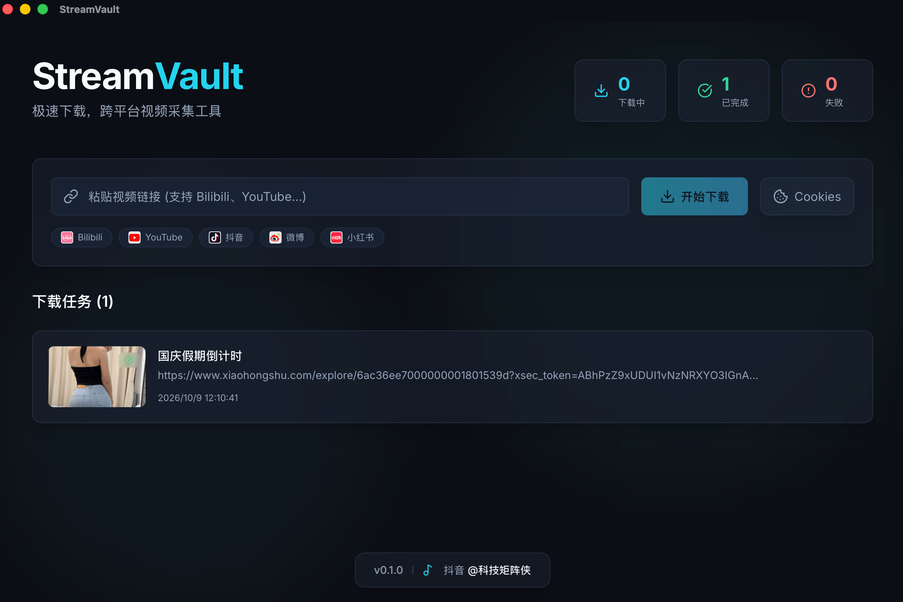

# StreamVault

一个现代化的视频下载工具，基于 Tauri 2 + React + yt-dlp 构建。



<br />

## 特性

- 🚀 极速下载，支持多平台（Bilibili、YouTube、抖音等）
- 🎨 炫酷的现代化 UI，流畅的动画交互
- ⚡️ 基于 Tauri 2，体积小、性能强
- 📦 跨平台支持（当前已构建 macOS Apple Silicon 版本）
- 🔄 实时进度追踪，支持暂停/恢复
- 🎯 智能格式选择，自动解析视频信息
- 🧰 内置 yt-dlp + ffmpeg + ffprobe，无需用户单独安装依赖
- 🍪 Cookies 支持：自动读取浏览器登录态；登录过期时一键引导登录并重试

## 技术栈

- **前端框架**: React 18 + TypeScript
- **UI 库**: Tailwind CSS + Framer Motion
- **桌面框架**: Tauri 2
- **下载引擎**: yt-dlp 2026.08.19
- **音视频处理**: ffmpeg 9.0 + ffprobe（内置打包）

## 开发环境要求

- Node.js 18+
- Rust 1.70+
- pnpm/npm/yarn

## 快速开始

### 安装依赖

```bash
npm install
```

### 下载内置二进制

yt-dlp / ffmpeg / ffprobe 体积较大，不纳入 Git 管理，克隆后需先拉取：

```bash
./scripts/download-binaries.sh
```

### 开发模式

```bash
npm run tauri dev
```

### 构建应用

```bash
npm run tauri build
```

## 项目结构

```
streamvault/
├── src/                    # 前端源码
│   ├── api/               # Tauri 命令封装
│   ├── components/         # React 组件
│   ├── types/             # TypeScript 类型定义
│   ├── App.tsx            # 主应用组件
│   └── main.tsx           # 入口文件
├── src-tauri/             # Tauri 后端
│   ├── binaries/          # 内置 yt-dlp/ffmpeg/ffprobe 二进制
│   ├── capabilities/      # Tauri 2 权限配置
│   ├── src/
│   │   ├── commands.rs    # Tauri 命令
│   │   ├── ytdlp/         # yt-dlp 封装
│   │   └── main.rs        # Rust 入口
│   └── tauri.conf.json    # Tauri 配置
└── package.json
```

## TODO

- [x] 实现 yt-dlp 调用逻辑
- [ ] 添加格式选择器（数据已解析，UI 未接入）
- [x] 实现下载队列管理（暂停/恢复/取消）
- [ ] 添加设置面板（代理、路径等）
- [ ] 支持批量下载
- [ ] 添加下载历史记录

## License

MIT
